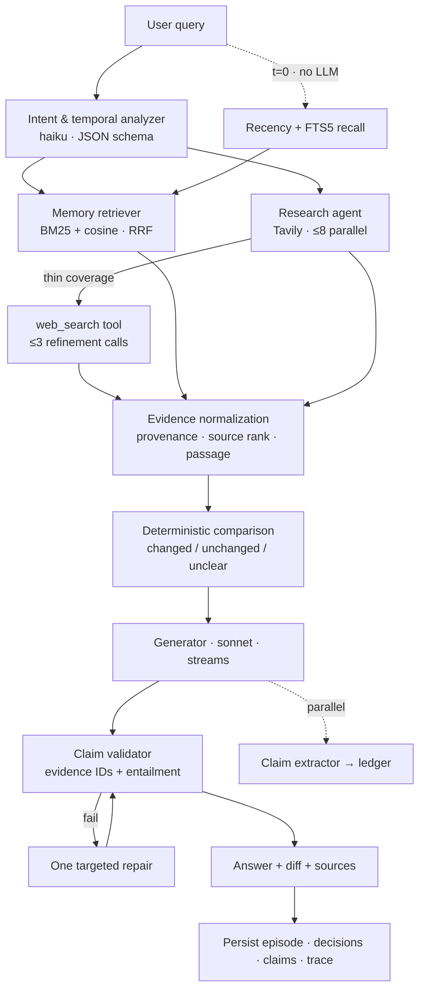

# Since

**A chat agent that remembers what it told you — and proves what changed.**

## The bet

Every assistant can search. Almost none can answer "we talked about this on Monday — has anything changed?" honestly, because they store transcripts, not facts. A transcript records what was said; it cannot tell you which vendor was $20 per seat, when that was observed, or whether the page still says so.

Since treats history as a **dated record of statements and evidence**. It keeps three things apart: what the user said, what the assistant answered, and what a source showed at the time. A follow-up becomes a verification job: recall the observation, re-check the source, normalize comparable attributes, diff, report. Three guarantees hold it up:

- **Historical integrity** — reconstruct what was said and known then.
- **Comparison integrity** — report a change only when the observations are comparable.
- **Evidence integrity** — every important fact is backed by an inspectable source, or marked unverified.

## How a turn works

**Each step and its budget. These are targets, not measurements.**

1. **t=0, no model call.** Recent turns and FTS5 candidates load immediately; the query embedding runs beside the analyzer.
2. **Analyze (~400 ms, haiku).** One structured call returns intent (`fresh`, `recall`, `recheck`, `chat`), entities and aliases, dates as half-open UTC intervals from one reference instant, volatility per attribute, and a search plan. `chat` covers greetings, meta, opinions and stable explanations; anything that may change over time stays `fresh` so it gets a stored baseline.
3. **Recall (~0 ms added).** BM25 plus cosine, fused with RRF. Retrieval returns an explicit outcome: `exact`, `likely`, `multiple`, `not_found`, `insufficient_context`.
4. **Route.** Chat answers directly with the conversational prompt; stable recall needs no search; volatile recall becomes a recheck; fresh skips comparison. This is why "what did I ask on 3 Nov" takes a second, not eight.
5. **Research (~1.5–3 s).** One query per entity plus one recency query, up to eight in parallel, six-second budget. Thin coverage gives a research LLM the single `web_search` tool for at most three refinement calls. Every result becomes an evidence row: URL, domain, title, published date, passage, hash, source rank.
6. **Extract claims (after research, before comparison).** Haiku records observations with provenance (`user_statement`, `assistant_statement`, `web_observation`) and verification (`unverified`, `verified`, `disputed`, `inaccessible`). Only web observations can be verified; repetition never promotes an assistant statement.
7. **Normalize and compare (code).** Prices carry amount, currency, period, mode, unit, plan, region and conditions. Comparison is field by field, records the specific reason (`price_increased`, `unit_changed`, `billing_period_changed`, `plan_changed`, `limit_changed`, `discontinued`, `no_material_change`, `insufficient_evidence`) and exposes changed / unchanged / unclear. An unsourced old value is never a confirmed baseline.
8. **Generate (sonnet, streams).** Evidence IDs only (`[e3]`), never URLs. Rechecks render the deterministic diff table before the prose.
9. **Validate (overlapped).** Batched entailment checks pending claims while the last tokens arrive. One targeted repair; otherwise a visible correction replaces the sentence. Nothing is shown as verified before it passes.
10. **Persist.** Episode, embedding, decisions, claims, evidence, trace. Transactional, serialized per session, idempotent retries; the next turn waits on a write barrier.

**Tool boundary.** The model sees exactly one tool: `web_search`. Tavily is its adapter. OpenRouter and Gemini are model and embedding providers, not tools. Memory, SQLite, comparison, validation and persistence are deterministic pipeline components the model cannot call. The HTTP API and UI are outside the agent entirely.

## Memory model

Seven tables in one SQLite file, FTS5 on episode text, embeddings as BLOBs with cosine in JS:

| Table | Holds | Why |
|---|---|---|
| `sessions`, `turns` | Transcript, UTC time, status, `is_synthetic`, trace | Replay and ordering |
| `episodes` | Question, answer, entities, embedding | "What did I ask on 3 Nov" |
| `entities` | Canonical name, domain, aliases, embedding | "Postgres" = "PostgreSQL" |
| `claims` | Entity, attribute, value, `source_type`, `verification`, `observed_at`, `published_at`, `effective_from`, source, `supersedes_id` | The diffable truth |
| `decisions` | Topic, type (`shortlist`, `selection`, `preference`), entity IDs, source turn | "Shortlisted five" ≠ "mentioned ten" |
| `checks` | Query, provider, fetched-at, results, TTL class | Cache and audit |

Claims are append-only: a new observation supersedes but never deletes the old, so "what did I say then" returns exactly that, while "is it still true" compares with today. `effective_until` comes from the supersession chain. Seeded rows carry `is_synthetic` and are never silently mixed with real history.

## Evidence rules

- Search results are **leads, not proof**; the supporting passage is stored, not just a hash.
- Source rank: official = 3, reputable press = 2, community = 1. Price claims need ≥2; lower ranks are context only. Official vendors win for price, otherwise the newest dated source within the same rank; material conflicts show both.
- Normalize before diffing: `$20/user/month` vs `$20/workspace/month` is a unit change, not "unchanged"; `$25/month` vs `$25/month billed annually` is a billing-mode change.
- A future-dated announcement is reported as announced, not effective. Inaccessible sources produce `insufficient_evidence`, not a guess.

## Missing memory

| Outcome | Response |
|---|---|
| Exact | Answer from the episode |
| Likely | State the date and topic used |
| Multiple | One clarification question |
| Not found | Say history is unavailable; never invent |
| Insufficient context | Ask for the missing date or topic |

Dates resolve against one reference instant in the user's timezone (default `Asia/Kolkata`) into a half-open UTC interval; ambiguity is surfaced only at low confidence.

## Why this shape

- **LangGraph, thin.** Nodes map to the diagram; conditional edges express the fast path and repair loop. Business logic stays in plain functions, and the ledger is the state of record — no checkpointer.
- **Two tiers.** Haiku for analysis, extraction and validation; Sonnet for synthesis. About 10× cheaper than using the big model everywhere.
- **Evidence IDs, not URLs.** Validation is set membership plus entailment.
- **SQLite + FTS5 + in-process cosine.** No vector service, no native build. Cache by volatility: price 10 minutes, features one day, stable facts 30 days; history never expires.

## Considered and rejected

| Rejected | Why |
|---|---|
| Transcript-only memory | Can't date claims, can't diff |
| Assistant statements as facts | Repetition is not verification |
| Free-form search loop | Unbounded latency |
| Newest source always wins | A blog shouldn't override the vendor page |
| Model-written URLs | Hallucinated links |
| Blocking validation | Doubles time-to-first-token |
| Mutating claims | Destroys the audit trail |
| Vector DB or policy engine | Weight without a measured need |

## Evals

`npm run eval` uses a scratch database, a synthetic three-session history and 16 scenarios in seven categories: 11 memory-only (recall-nov3, recall-monday, recall-last-tuesday, followup, date-nov3, date-last-tuesday, missing-history, synthetic-label, no-fabrication, chat-greeting, chat-general) and 5 live-search (crm-recheck, postgres-recheck, fresh-hubspot, unverified-baseline, citation-support). It writes a per-scenario JSON report to `evals/results/` (gitignored), so reviewers can rerun it. Comparison and date logic also get deterministic fixture tests, because live results cannot be ground truth for arithmetic.

Each scenario gates several hard assertions: correct episode and entities, correct date interval, correct comparison status, citations present and supported, no invented history, abstention where evidence is missing. A judge scores question fit, conciseness and honesty; it is reported, not gated. The per-scenario report records pass/fail/skip, latency, first-token time, planned searches and judge scores; the summary adds p50/p95.

**Measured (16 Nov 2026, live search enabled, 0 skipped):** 16/16 scenarios passed; p50 4133 ms, p95 22353 ms; first token 873–17186 ms; judge means 4.50 answers / 4.06 concise / 4.75 honest. Memory-only turns run in 2594–5994 ms; live rechecks take 14056–22353 ms because search, extraction and validation dominate. The 8 s p50 and 15 s p95 targets hold for memory-only turns, not for live multi-vendor rechecks; that is the first thing to optimize next.

## Limits

- Synthetic demo history is labeled at row level and in the UI. Old values are plausible, not quotes.
- Extraction is lossy; "per seat" vs "per workspace" can cause a false diff, so the diff shows plan, unit and period.
- Tavily cannot see logged-in or paywalled pages; the agent says so.
- Search and refinement cancel at their configured budgets, but a turn itself has no wall-clock deadline.
- Single user, localhost, no auth; rechecks are on demand, no scheduler.
- Only retrieved passages go to model providers, never the full transcript. Free-tier embeddings may train Google's products; embedded text is public or synthetic.

## Another week

1. **Scheduled verification** — nightly re-checks and change notifications.
2. **Archived sources** — real "as of 3 Nov" quotes instead of seeded approximations.
3. **Span-level entailment** — check the exact fragment against the exact quote.
4. **Adaptive routing** — escalate only when the validator is uncertain.
5. **A human-labelled eval set** — a hundred cases, not sixteen.
